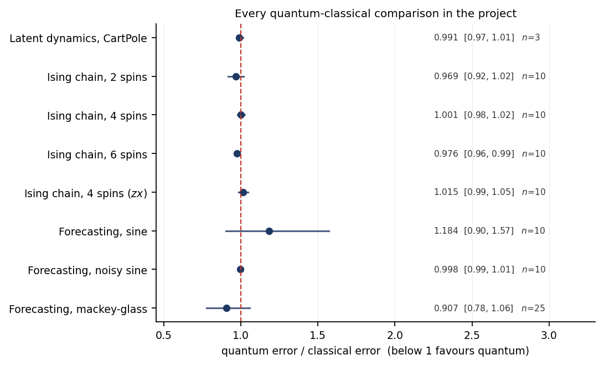
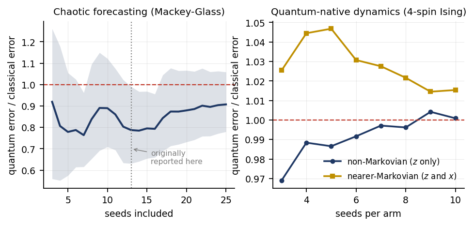
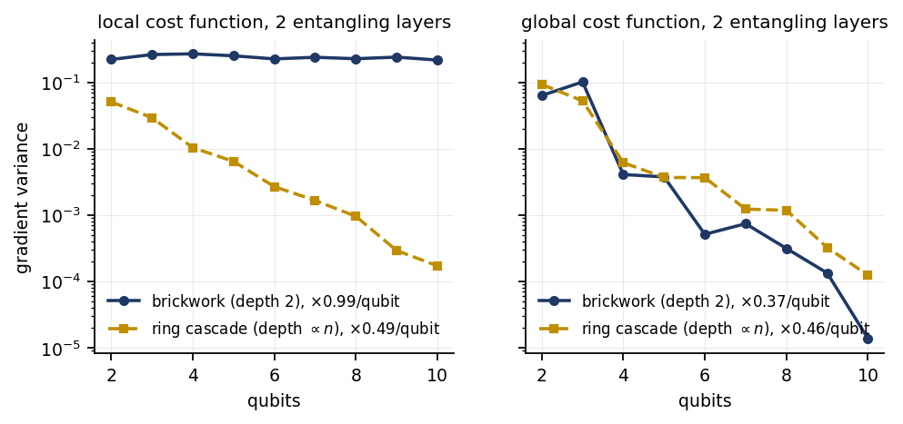

## 1. Introduction

The central empirical question in quantum machine learning is whether a model
containing a parameterised quantum circuit outperforms a classical model of
comparable size. The question is simple to state and, as it turns out, very
difficult to answer.

The difficulty is not conceptual. It is that the effect sizes claimed in the
literature are typically of the same order as the seed-to-seed variation of the
models being compared, while the number of seeds reported is typically between
three and ten. Under those conditions a comparison has very little resolving
power, and the probability of observing an apparent advantage when none exists
is high.

This paper makes that concrete. We ran a quantum transformer dynamics model
against size-matched classical transformers across eight settings, applying a
protocol designed to close the specific failure modes we encountered. The
headline result is that nothing works: no comparison produces an advantage whose
interval excludes parity. The more useful result is *how* the nulls were
reached, because in two cases we first obtained an apparent advantage and then
watched it dissolve as the sample grew.

Our contribution is threefold:

1. A six-point evaluation protocol, each point motivated by a failure we
   observed in our own work rather than hypothesised.
2. Two direct demonstrations of small-sample collapse, one of which includes a
   pre-committed out-of-sample replication.
3. Evidence that the gradient-variance diagnostic used to select circuit
   architectures is confounded by entangler topology, so the protocol must
   extend to the tools used to design experiments, not only to the experiments.

We make no claim that quantum advantage in sequence modelling is impossible. We
claim that at simulable scale the current reporting conventions cannot establish
it, and that several published results are consistent with the behaviour we
observed before adding seeds.

---

## 2. Related work

**[AUDIT — this section needs a literature pass before submission. The
following is scaffolding, not a survey.]**

Quantum attention architectures: QASA, Quixer, SASQuaTCh, QSANN, HQViT.
Position the present work as an evaluation study of this family rather than a
new architecture.

Trainability: Cerezo et al. on cost-function locality and barren plateaus;
Larocca et al. review. Section 6 bears directly on how these results are applied
in practice, so this needs care — in particular, whether the depth-versus-layer
conflation we document has been noted before.

Reproducibility in machine learning: Henderson et al. on deep RL variance,
Bouthillier et al. on accounting for randomness, Agarwal et al. on statistical
reporting. The argument we make is their argument, transposed to a field where
the per-run cost is higher and sample sizes are correspondingly smaller.

World models: Hafner et al., DreamerV3. Relevant as the architectural context
for the dynamics models evaluated here.

---

## 3. The protocol

Each item below is stated as a requirement, followed by the failure that
motivated it. All six are failures we committed and then detected, which is the
reason we believe they are easy to commit.

### P1 — Report trivial predictors alongside every error

Every reported error must be accompanied by the error of *persistence*
(predict no change), a *linear extrapolation*, and the *training-set mean*, each
computed on the same test split.

*Motivating failure.* Our early results quoted mean squared errors in the range
0.002–0.02 with no scale reference. Such a number carries no information: on one
of our tasks persistence scores 0.0599 and on another 0.0324, so the same
absolute error represents very different degrees of success. Reviewers cannot
detect this and neither could we until baselines were added.

### P2 — Establish that the benchmark can discriminate

Report the coefficient of determination and the ratio to persistence at every
comparison. A comparison in which both models exceed $R^2$ $\approx$ 0.999 should not be
interpreted.

*Motivating failure.* Our first dynamics comparison placed both architectures
above $R^2$ = 0.999. The difference between them was a difference in the fourth
decimal place of a task that both had effectively solved, and no architectural
conclusion could be drawn from it. The comparisons reported here sit at
$R^2$ = 0.81–0.87, where capacity still binds. We verify this directly by widening
the classical model: at four spins, error falls monotonically from 0.0268 at
`d_model` = 8 to 0.0177 at `d_model` = 64 without flattening, confirming that
the operating point is capacity-limited rather than saturated.

### P3 — Vary the seed over initialisation only

The train/validation/test partition must be fixed across seeds. Splitting by
whole trajectory, never by window, so that no training window overlaps a test
window.

*Motivating failure.* Our Phase 1 experiments reshuffled the data partition with
the seed as well as the model initialisation. The resulting seed-to-seed
variance was approximately six times the effect size under investigation
**[AUDIT — recompute this multiple from the raw runs]**, consuming the study's
statistical power for no methodological benefit.

### P4 — Declare the detectable effect size before running

State, before data collection, the effect the planned sample can resolve. Where
the planned sample cannot resolve the effect of interest, say so.

*Motivating failure.* Our Ising control experiment was initially run at three
seeds per arm. With three versus three, the smallest attainable two-sided
p-value from an exact permutation test is 0.100 — the design could not have
produced a significant result under any data whatsoever. We nonetheless observed
a 5.6-point separation in the predicted direction and treated it as a lead. It
was not one (Section 5.2). Separately, we estimate that detecting a 20% effect
in closed-loop reinforcement learning at this scale requires on the order of 78
seeds **[AUDIT — recompute from the Phase 2 return variances]**.

### P5 — Pre-specify a paired, distribution-free test

Comparisons must be paired within seed, since the seed is a shared source of
variation. We use a permutation test on log-ratios — logarithms because ratios
are multiplicative, so that 0.90 and 1.11 are treated as equal and opposite —
with exact enumeration of sign assignments where the sample permits.

*Motivating failure.* The same thirteen seeds of our chaotic-forecasting
comparison yield p = 0.022 under the test originally applied and p = 0.069 under
the paired permutation test on log-ratios. Nothing about the data changed. The
choice of test moved the result across the conventional threshold.

### P6 — Make run identity collision-safe

The run identifier must encode every configuration dimension that is varied. The
analysis must assert that no two runs collide on the key it groups by.

*Motivating failure.* Our Phase 3 analysis grouped results by model, system size
and seed. When a capacity sweep introduced runs at three additional widths into
the same directory, the narrowest model silently overwrote the intended one at
analysis time, which would have inflated the apparent quantum advantage. The
error produced no warning and the resulting table looked entirely ordinary.

---

## 4. Experimental setting

**Architectures.** A transformer encoder in which one token-mixing block is
replaced by a parameterised quantum circuit (6 qubits, 4 layers, brickwork
entangler, angle encoding with data re-uploading, local Pauli-Z readout), versus
an identical transformer with a classical block in the same position. Parameter
counts are matched to within 15% by construction and verified per run; typical
counts are 7,274 quantum against 7,518 classical, of which 28 parameters are
circuit parameters.

**Tasks.**

| Setting | Dynamics | Observations |
|---|---|---|
| Latent control dynamics | CartPole, DreamerV3 latents | 6-dim compressed latent |
| Synthetic forecasting | sine, noisy sine, Mackey-Glass | scalar series, lookback 24 |
| Quantum-native dynamics | transverse-field Ising chain, 2–6 spins | $\langle Z \rangle$, optionally $\langle X \rangle$ |

The Ising chain is evolved exactly by dense matrix exponentiation, eliminating
Trotter error as a confound. Its control field switches among five levels, and
by default only $\langle Z_i \rangle$ is recorded — those N numbers do not determine the quantum
state, so prediction requires history. Recording $\langle X_i \rangle$ as well moves the task
closer to Markovian and serves as a control arm (Section 5.2).

**Evaluation.** One-step error plus open-loop rollout at horizons 5, 10 and 20,
in which the model consumes its own predictions. We report both short and long
horizons throughout, because which one discriminates depends on how smoothly the
dynamics evolve and our two environments gave opposite answers **[AUDIT]**.

---

## 5. Results

### 5.1 No advantage anywhere

**Figure 3.** Geometric-mean ratio of quantum to classical test error, with 95%
bootstrap confidence intervals, for every comparison conducted. Values below 1
favour the quantum model.

| Setting | n | ratio | 95% CI | quantum ahead | p |
|---|---|---|---|---|---|
| Latent dynamics, CartPole | 3 | 0.991 | [0.974, 1.014] | 2/3 | 0.500 |
| Ising chain, 2 spins | 3 | 0.956 | [0.810, 1.115] | 2/3 | 0.750 |
| Ising chain, 4 spins | 10 | 1.001 | [0.979, 1.025] | 6/10 | 0.943 |
| Ising chain, 6 spins | 3 | 0.975 | [0.936, 1.008] | 2/3 | 0.500 |
| Ising chain, 4 spins (zx) | 10 | 1.015 | [0.987, 1.047] | 4/10 | 0.375 |
| Forecasting, sine | 3 | 1.265 | [0.913, 2.112] | 1/3 | 0.750 |
| Forecasting, noisy sine | 3 | 1.001 | [0.987, 1.012] | 1/3 | 1.000 |
| Forecasting, Mackey-Glass | 25 | 0.907 | [0.780, 1.059] | 16/25 | 0.240 |

Every interval contains 1. Note also that the three-seed intervals are wide
enough to be nearly uninformative — the sine comparison admits ratios from 0.91
to 2.11 — which is the practical meaning of P4.

The quantum models are also roughly 20$\times$ more expensive in wall-clock terms
(median 4,136 s against 182 s on the CartPole task, 440 s against 23 s on the
Ising task), though we note that our timings are contaminated by machine sleep
and competing load and should be treated as lower bounds on the ratio.

### 5.2 Two collapses

**Figure 1.** The estimate a researcher would have reported having stopped after
*n* seeds. **Left:** chaotic forecasting, with 95% bootstrap band. **Right:** the
two arms of the Ising observables contrast.

**Chaotic forecasting.** At 13 seeds the quantum model's error ratio was 0.787
— a 21% improvement, 9 wins in 13. We then ran twelve further seeds for the
specific purpose of testing this claim, which makes them an out-of-sample
replication. Those twelve give a ratio of 1.058: the classical model is
marginally ahead. Pooled over all 25 seeds the ratio is 0.907 with a 95%
interval of [0.780, 1.059] and a permutation p of 0.240.

The per-seed ratios span 0.376 to 2.244 — a six-fold range on a task where the
data is byte-identical across seeds and only the weight initialisation varies.
Against dispersion of that magnitude, thirteen seeds could never have resolved a
20% effect.

**The observables contrast.** The hypothesis under test was that quantum
attention helps where prediction requires history. At three seeds per arm the
non-Markovian arm sat at 0.969 and the nearer-Markovian arm at 1.025 — a
separation of 5.6 points in the predicted direction. At ten seeds per arm the
arms sit at 1.001 and 1.015, a separation of 1.4 points, and the separation
reverses sign between horizons (-0.4 points at k = 10). We take the sign
reversal as the clearest indication that the quantity being estimated is zero.

### 5.3 The diagnostic is confounded too

**Figure 2.** Gradient variance against circuit width, by cost-function
locality and entangler topology, at two entangling layers.

Cost-function locality is understood to protect against barren plateaus at
shallow depth. Our measurements reproduce that protection — but only for one of
two entangler topologies in common use.

| cost | entangler | 2 layers | 4 layers | 6 layers |
|---|---|---|---|---|
| global | brickwork | $\times$0.366 | $\times$0.484 | $\times$0.500 |
| global | ring cascade | $\times$0.464 | $\times$0.484 | $\times$0.496 |
| local | brickwork | $\times$0.988 | $\times$0.963 | $\times$0.842 |
| local | ring cascade | $\times$0.491 | $\times$0.501 | $\times$0.504 |

*Decay factor in gradient variance per added qubit, from a log-linear fit over
2–10 qubits.*

Under a local cost at two entangling layers, brickwork shows essentially no
decay (variance 0.2206 $\rightarrow$ 0.2161 across 2 to 10 qubits) while the sequential ring
cascade decays by a factor of 295 over the same range. At ten qubits the two
differ by approximately 1,260$\times$. The global-cost rows serve as a control: there
the two topologies are indistinguishable, as expected, since global costs are
not protected.

The proximate explanation is that a ring cascade applies CNOTs sequentially, so
one nominal "layer" has circuit depth scaling with qubit count, whereas a
brickwork layer is depth 2 at any width. Plotting gradient variance against
*layers* with a sequential entangler therefore conflates layer count with depth,
and the shallow-depth condition required by the protection result is violated
while the axis label still reads two layers.

**We note an alternative explanation that our data do not exclude.** The two
topologies contain the same number of CNOTs per layer but arrange them
differently: the cascade creates a long-range correlation chain within a single
layer, brickwork couples only neighbours. The effect may therefore reflect
entangling structure rather than depth per se. Distinguishing these requires
holding circuit depth constant rather than layer count, which we have not done.
We report the confound, which is robust, and not the mechanism, which is not.

A further caution: these estimates use 100 gradient samples per configuration,
which is thin for a published decay rate. **[AUDIT — rerun at higher sample
count and add a depth-matched control before submission.]**

The practical consequence is immediate for us. We used this diagnostic to select
qubit count and circuit depth for every experiment reported above. A confounded
diagnostic does not merely distort conclusions; it distorts the design choices
made on the way to them.

---

## 6. Discussion

### What we are not claiming

We are not claiming that quantum models cannot outperform classical ones. Our
experiments operate at 6 qubits with 28 circuit parameters, simulated exactly on
a laptop. If a classical computer can simulate the circuit cheaply then the
circuit's function class is, by construction, classically reachable, and there is
no mechanism by which an advantage should appear. The theoretical arguments for
advantage apply at scales where simulation becomes hard. Our results say nothing
about those scales.

What our results do say is that the regime in which most empirical quantum
machine learning is currently conducted is a regime in which no advantage should
be expected on theoretical grounds and none can be reliably detected on
statistical grounds. That combination is worth naming.

### A structural trap

Our Ising experiments were designed to test the strongest available argument:
that a fixed-size quantum model should track a growing quantum system better
than a fixed-size classical one. The ratio was flat across system size, drifting
slightly the wrong way (0.956 at 2 spins to 0.975 at 6).

We note a difficulty that applies beyond our own study. Generating supervised
training data for a quantum system requires simulating that system. At sizes
where simulation remains tractable, a classical model has no difficulty
representing the dynamics; at sizes where the classical model would struggle,
the training data cannot be produced. The regime in which the advantage argument
bites is, for this experimental design, the regime in which the experiment
cannot be run.

### Implications for reporting

The resolving power of a study should be stated before its result. A comparison
at three seeds per arm, where the minimum attainable p-value exceeds the
conventional threshold, is not weak evidence — it is a design incapable of
producing evidence, and reporting the point estimate without that fact invites
exactly the inference the design cannot support.

---

## 7. Limitations

- Single architecture family; our conclusions may not transfer to quantum models
  structured differently.
- Exact expectation values throughout. Finite-shot behaviour, and therefore all
  behaviour on hardware, is untested. **[AUDIT — the shot-noise probe exists but
  has not been run.]**
- Our classical baseline is a transformer of matched parameter count. Matching
  by parameter count rather than by compute favours the quantum model, since its
  wall-clock cost is roughly 20$\times$ higher.
- Wall-clock measurements are contaminated by machine sleep and competing load.
- The gradient-variance measurements use 100 samples per configuration.
- The Ising comparison at 2 and 6 spins, and the latent-dynamics and
  non-Mackey-Glass forecasting comparisons, remain at 3 seeds. By our own P4
  these are reported as underpowered, not as evidence of parity.

---

## 8. Reproducibility

All code, run records and analysis scripts are available at **[AUDIT — repo
URL]**. Every figure and table in this paper is produced by `make_figures.py`
from the raw run records; intermediate values are dumped to
`figures/figure_data.json` so that the numbers in the text can be checked
against the numbers in the plots.

---

## Appendix A — Remaining audit items

Items flagged **[AUDIT]** above, collected:

1. Section 2 — literature survey, including whether the entangler depth
   confound has been documented previously.
2. P3 — recompute the seed-variance-to-effect-size multiple from raw runs.
3. P4 — recompute the 78-seed closed-loop estimate from Phase 2 return
   variances.
4. Section 4 — confirm the opposite-horizon-discrimination claim across the two
   Phase 1 environments.
5. Section 5.3 — rerun gradient variance at higher sample count; add a
   depth-matched control.
6. Section 7 — run the shot-noise probe, or remove the claim.
7. DreamerV3 baseline: only seed 0 completed. Any claim that the baseline
   reproduces published returns must be softened accordingly, or further seeds
   run.
