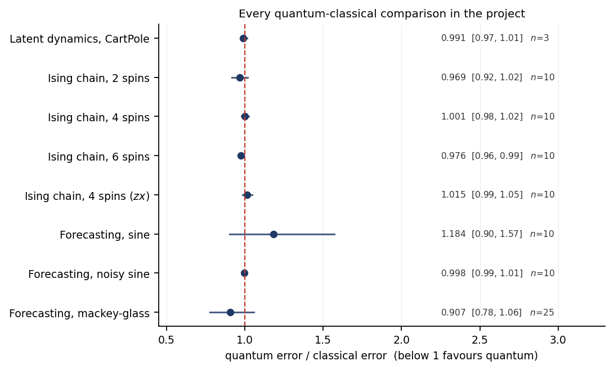
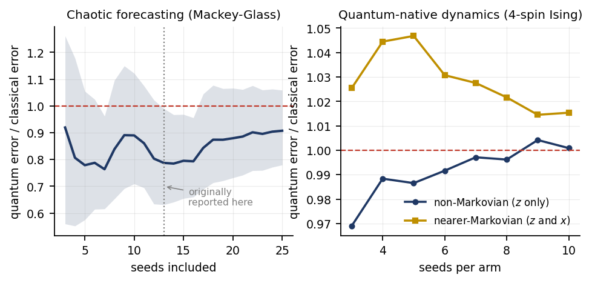
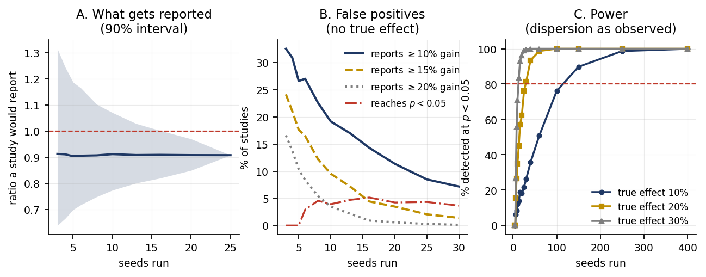
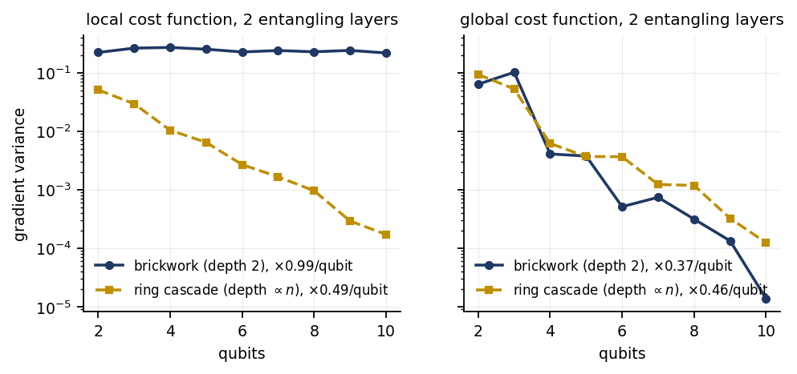
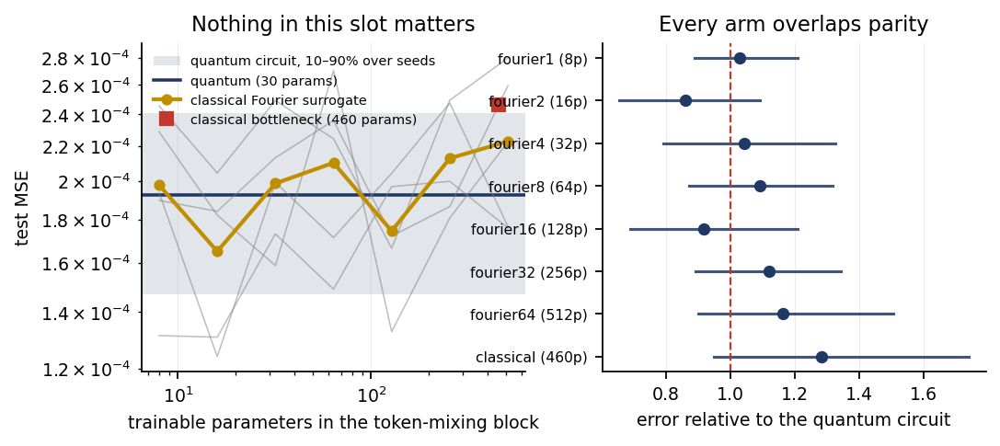

# How Many Seeds? Dispersion, Resolving Power, and a Failed Replication in Quantum Sequence Modelling

**V. Liutarevich**

*Draft v3 — 2026-10-02. Every number is recomputed from the run records by `make_figures.py` and `power_analysis.py`; figures and text share a single source of truth in `figures/`. Items marked **[AUDIT]** are not yet verified and must not survive into a submission.*

---

## Abstract

Recent work has established that quantum machine learning models rarely
outperform classical baselines at simulable scale, and that apparent advantages
often trace to architectural rather than quantum effects. We address a
complementary question that this work leaves open: whether the sample sizes in
routine use could detect such an advantage if one existed.

The quantity that decides this is seed-to-seed dispersion, which is almost never
reported. We measure it across four task settings using matched architectures
and find it spans a factor of twelve — standard deviation of the per-seed
log-ratio from 0.039 to 0.477. The consequence is that the sample required to
detect a 10% effect at 80% power varies from six seeds to a hundred and fifty, a
factor of twenty-five, with no way to tell which regime one is in without
measuring.

We demonstrate the practical effect with a failed replication. An apparent 21%
advantage on chaotic forecasting, observed at 13 seeds, did not survive twelve
further seeds run specifically to test it: the fresh seeds favour the classical
model and the pooled estimate over 25 seeds is 0.907 with a 95% interval of
[0.780, 1.059]. Resampling under the paired null shows why — at the dispersion
this task exhibits, more than one null study in four at five seeds reports a
10%-or-better advantage.

Across eight comparisons spanning classical control dynamics, synthetic
forecasting, and exactly-simulated transverse-field Ising dynamics, no interval
excludes parity. We report bounds rather than nulls: advantages above 2.1% are
excluded on quantum-native dynamics, above 22% on chaotic forecasting. We also
find that a small pilot cannot reliably estimate the sample size required — a
three-seed pilot implies anywhere between 4 and 170 — and conclude that
dispersion and interval estimates should be reported as standard, since the
required sample size cannot be cheaply forecast.

We then give a theoretical account of why no effect should be expected at this
scale, and test it. A data re-uploading circuit computes a truncated Fourier
series whose accessible frequencies are fixed by its encoding gates, so at
simulable scale it is a more constrained function class than the classical block
it replaces. Constructing the corresponding classical surrogate over the
circuit's own spectrum, we find an eight-parameter trigonometric map matches the
thirty-parameter circuit — and, more consequentially, that varying this block's
capacity over a 64-fold range moves performance less than changing the random
seed does.

That yields a second necessary condition, independent of sample size: the
component under comparison must constrain performance, or every candidate placed
in it performs alike and no amount of data makes the comparison informative. The
architecture evaluated here, on the benchmark where its advantage was first
reported, fails this condition.

---

## 1. Introduction

Does a model containing a parameterised quantum circuit outperform a classical
model of comparable size? Recent work has made substantial progress on this
question, and the answer at currently simulable scale is largely negative.
Bowles, Ahmed and Schuld [1] tested twelve quantum models across 160
classification datasets and found classical baselines generally superior, with
entanglement frequently dispensable. The authors of QASA [2], a quantum
transformer whose dynamics core we reproduce here, have revised their own work
to attribute its reported advantage to a low-rank value-projection bottleneck
rather than to the quantum substrate, as shown by a capacity-matched classical
control.

Both results concern confounds in the *architecture*: what is being compared.
This paper concerns a confound in the *measurement*: whether the comparison
could resolve the effect it reports.

The quantity that decides this is the dispersion of the models across random
initialisations. It is almost never reported, and without it neither author nor
reader can say whether ten seeds is generous or hopeless. We measure it across
four settings with matched architectures and find it varies twelvefold, moving
the sample required to detect a 10% effect from six seeds to a hundred and
fifty.

We then show what follows, with a failed replication: an apparent advantage that
dissolves under additional seeds drawn specifically to test it, and a
quantification — from resampling our own runs rather than from assumed
distributions — of how often a study with no true effect would report one.

**Contributions.**

1. **A measurement of seed dispersion** across four task settings with matched
   architectures, with intervals, and the sample size each implies (Section 6).
2. **A failed replication with a pre-committed out-of-sample test** (Section 5),
   independently corroborating the revised conclusion of the source paper [2] by
   a different route.
3. **False-positive rates estimated from observed dispersion**, the empirical
   counterpart to the simulation-based publication-bias argument of [1].
4. **Evidence that a small pilot cannot forecast the required sample size**,
   which constrains what can usefully be recommended (Section 6).
5. **A measured magnitude for a trainability-diagnostic pitfall**: a common
   entangler choice violates the depth precondition of the local-cost protection
   result, changing measured gradient variance by roughly 1,260× at ten qubits
   (Section 7).
6. **A theoretical account of why no effect is expected** at this scale, tested
   with a classical surrogate constructed over the circuit's own accessible
   frequency spectrum (Section 8).
7. **A second necessary condition for architectural comparison** — that the
   component under test must constrain performance — which the benchmark
   underlying the original claim fails, and which no sample size can repair
   (Section 8.3.1).

We do not claim that quantum advantage in sequence modelling is impossible.
Section 8 argues the stronger and more specific point that at simulable scale no
expressivity advantage is available in principle — the circuit computes a
truncated Fourier series whose classical counterpart we construct explicitly —
leaving inductive bias as the only live mechanism, which our measurements bound
at 2.1%. That argument applies to variational models with generic ansätze; it
does not extend to problem-informed circuits or to non-variational approaches,
and we say so.

The methodological claim is separate and narrower: in the regime where most
empirical work takes place, small effects cannot be resolved by the samples in
use, and the conventions of the field make this invisible.

---

## 2. Related work

**Benchmarking and evaluation.** Bowles et al. [1] conduct the most extensive
evaluation of quantum machine learning models to date — twelve architectures,
160 classification datasets — finding classical baselines generally superior and
entanglement often dispensable. They argue further, through simulation, that
publication bias over a large design space can invert an apparent ranking. Our
work is complementary in two respects. Where they go broad, using five-fold
cross-validation per configuration, we go deep: the split is held fixed and only
initialisation varies, so that seed dispersion is isolated and can be measured.
And where their publication-bias argument assumes performance distributions, we
estimate false-positive rates from the dispersion our own runs exhibit.

**Capacity-matched controls.** The QASA architecture [2], whose quantum
token-mixing block we reproduce, has been revised to argue that its reported
advantage is attributable to a low-rank value-projection bottleneck rather than
to quantumness, demonstrated by a classical control of identical parameter
budget. Our null on chaotic forecasting is consistent with that conclusion,
reached independently and by a different route: we hold capacity matched
throughout and vary the number of seeds. We adopt their control as a
requirement, not a contribution.

**Trainability.** Cerezo et al. [3] show that local cost functions avoid barren
plateaus provided ansatz depth remains $O(\log n)$ — a condition expressed
through the causal cones of the cost terms. Section 7 reports the empirical
consequence of violating that condition inadvertently, through an entangler
choice whose nominal layer count understates its depth.

**Variance in machine learning benchmarks.** Our statistical argument follows
established work in classical machine learning [4–7] on seed variance, interval
estimation and the inadequacy of small-sample comparisons, transposed to a
setting where per-run cost is far higher and reported samples are correspondingly
smaller — which makes the problem more acute, not less. Recent work benchmarking
quantum models on chaotic dynamics [8] reports a comparator at $47.9 \pm 36.6$,
a standard deviation 76% of the mean, illustrating the magnitudes involved in
precisely our setting.

**[AUDIT — exact citations, years and venues for [4–8]. Also outstanding: a
search for any quantum machine learning paper that reports seed dispersion and
derives a required sample size. If one exists, contribution 1 weakens.]**

---

## 3. Experimental setting

**Architectures.** A transformer encoder in which one token-mixing block is
replaced by a parameterised quantum circuit (6 qubits, 4 layers, brickwork
entangler, angle encoding with data re-uploading, local Pauli-$Z$ readout),
against an identical transformer with a classical block in the same position.
Following [2], the classical control is a capacity-matched low-rank bottleneck
of the same parameter budget rather than a full-width block: in the forecasting
experiments it projects $d_{\text{model}} \rightarrow n_{\text{qubits}}
\rightarrow \text{hidden} \rightarrow d_{\text{model}}$ with the same budget as
the circuit it replaces. Parameter counts are matched to within 15% by
construction and verified per run: typically 7,274 against 7,518, of which 28
are circuit parameters.

**[AUDIT — confirm the dynamics-model classical control (`DynamicsCore`,
`quantum=False`) is likewise a bottleneck rather than full-width. If it is
full-width, the Ising and CartPole comparisons are not capacity-matched in the
sense of [2] and must be qualified.]**

**Tasks.**

| Family | Dynamics | Observations |
|---|---|---|
| Latent control dynamics | CartPole, DreamerV3 latents | 6-dim compressed latent |
| Synthetic forecasting | sine, noisy sine, Mackey-Glass | scalar series, lookback 24 |
| Quantum-native dynamics | transverse-field Ising chain, 2–6 spins | $\langle Z \rangle$, optionally $\langle X \rangle$ |

The Ising chain is evolved exactly by dense matrix exponentiation, removing
Trotter error as a confound. Its control field switches among five levels. By
default only $\langle Z_i \rangle$ is recorded: those $N$ numbers do not
determine the quantum state, so prediction requires history. Recording
$\langle X_i \rangle$ as well moves the task nearer Markovian and serves as a
control arm.

**Why exact simulation, and what it costs.** All circuits are simulated exactly
by statevector, with gradients obtained by backpropagation through the
simulator. This is deliberate, and it is the conservative choice: the quantum
models are trained under conditions no physical device provides — no gate noise,
no decoherence, no readout error, exact rather than shot-estimated gradients,
and effectively infinite measurement budget. Every one of these favours the
quantum model. A comparison that the quantum architecture loses under ideal
conditions it will not win under realistic ones, so a null obtained this way is
stronger than a null obtained on hardware, not weaker.

Running on a device would answer a different question — whether a quantum model
remains usable despite noise — and would add dispersion rather than remove it,
which is the opposite of what a comparison needs. A larger classical simulator
would permit more qubits; the largest comparable study reaches 18 [1], which is
still well within classical reach and so does not change the theoretical
situation. What additional compute would most usefully buy is *more seeds*, and
we note the reflexivity: this study is sample-limited by available compute,
which is precisely the constraint that produces the field-wide problem we
measure in Section 6. The dispersion result itself does not depend on qubit
count.

**Protocol.** Data are split by whole trajectory, never by window, and the split
is fixed across seeds so that seeds vary model initialisation only. Every error
is reported alongside persistence, linear-extrapolation and training-mean
predictors on the same split. Comparisons are paired within seed and tested by
permutation on log-ratios — logarithms because ratios are multiplicative, so
that 0.90 and 1.11 count as equal and opposite — with exact enumeration of sign
assignments where the sample permits. Evaluation covers one-step error and
open-loop rollout at horizons 5, 10 and 20, in which the model consumes its own
predictions.

---

## 4. Results, and the bounds on them

### 4.1 The measurement detects architectural effects of the relevant size

A comparison returning ratios near unity invites two readings: that the
architectures perform equivalently, or that the measurement is insensitive. We
separate them before reporting results.

**The two models are distinct.** On the Ising four-spin task, per-seed
differences between quantum and classical error swing in both directions, from
−0.00105 to +0.00137, with a cross-seed correlation of −0.236. The mean absolute
difference is 2.08× the quantum model's own seed-to-seed standard deviation.
Were the quantum block inactive, the correlation would approach unity and the
differences would vanish; these are distinct models that perform equivalently.

**The pipeline resolves effects an order of magnitude smaller than it would need
to.** Using the same task, metric and evaluation code, widening the classical
model alone produces a measurable, monotonic change:

| $d_{\text{model}}$ | parameters | error ($k=1$) | ratio to $d=16$ |
|---|---|---|---|
| 8 | 3,306 | 0.02676 | 1.311 |
| 16 | 7,386 | 0.02041 | — |
| 32 | 18,618 | 0.01973 | 0.967 |
| 64 | 53,370 | 0.01768 | **0.867** |

Classical width alone yields a **13%** improvement from $d=16$ to $d=64$. The
quantum substitution at matched capacity yields **−0.1%**. The instrument
therefore registers an architectural effect of 13% on this task while
registering nothing from the quantum substrate, which establishes that ratios
near unity reflect the absence of an effect rather than the absence of
sensitivity.

**[AUDIT — the $d \in \{8, 32, 64\}$ rows are single-seed; rerunning at three
seeds is cheap and would let this table carry intervals.]**

**Figure 1.** Geometric-mean ratio of quantum to classical test error with 95%
bootstrap intervals, for every comparison conducted. Values below 1 favour the
quantum model.

| Setting | n | ratio | 95% CI | quantum ahead | p |
|---|---|---|---|---|---|
| Latent dynamics, CartPole | 3 | 0.991 | [0.974, 1.014] | 2/3 | 0.500 |
| Ising chain, 2 spins | 3 | 0.956 | [0.810, 1.115] | 2/3 | 0.750 |
| Ising chain, 4 spins | 10 | 1.001 | [0.979, 1.025] | 6/10 | 0.943 |
| Ising chain, 6 spins | 3 | 0.975 | [0.936, 1.008] | 2/3 | 0.500 |
| Ising chain, 4 spins ($zx$) | 10 | 1.015 | [0.987, 1.047] | 4/10 | 0.375 |
| Forecasting, sine | 10 | 1.184 | [0.902, 1.571] | 4/10 | 0.285 |
| Forecasting, noisy sine | 3 | 1.001 | [0.987, 1.012] | 1/3 | 1.000 |
| Forecasting, Mackey-Glass | 25 | 0.907 | [0.780, 1.059] | 16/25 | 0.240 |

Every interval contains 1. We decline to describe this as evidence of no effect,
because the intervals differ enormously in what they exclude. Read as bounds:

- **Ising chain, 4 spins, 10 seeds.** Interval [0.979, 1.025]: any advantage
  above **2.1%** is excluded. A tight, informative null.
- **Mackey-Glass, 25 seeds.** Interval [0.780, 1.059]: only advantages above
  **22%** are excluded. A 15% advantage remains entirely consistent with these
  data.
- **Sine, 10 seeds.** Interval [0.902, 1.571] — wider at ten seeds than the
  Ising interval at ten seeds by a factor of twenty-four, on a task that appears
  easier.
- **Three-seed comparisons.** Not weak evidence but very nearly no evidence, and
  reported as such.

A table of eight ratios all near 1 would support a far stronger conclusion than
these data license. The difference between a 2% bound and a 22% bound is the
whole question, and it is invisible unless intervals are reported.

The quantum models are also roughly 20× more expensive in wall-clock terms
(median 4,136 s against 182 s on CartPole; 440 s against 23 s on the Ising
task). Our timings are contaminated by machine sleep and competing load and
should be read as lower bounds on that ratio.

---

## 5. A failed replication

**Figure 2.** The estimate a study would have reported had it stopped after $n$
seeds. **Left:** chaotic forecasting, with 95% bootstrap band. **Right:** the two
arms of the Ising observables contrast.

**Chaotic forecasting.** At 13 seeds the quantum model's error ratio was 0.787 —
a 21% improvement, 9 wins in 13, with $p = 0.022$ under an unpaired test of the
mean. Twelve further seeds were then run for the sole purpose of testing this
estimate, making them an out-of-sample replication committed to before the data
were seen. Those twelve give 1.058: the classical model marginally ahead. Pooled
over 25 seeds the ratio is 0.907, interval [0.780, 1.059], permutation $p =
0.240$.

An estimate of this kind is what a study reporting 13 seeds would publish, and
Section 6.2 gives the rate at which the null produces it: at this task's
dispersion, 17% of thirteen-seed studies report a 10%-or-better advantage with
no effect present.

This is consistent with the revised conclusion of [2], arrived at independently.
Where those authors attribute the apparent gain to a low-rank bottleneck by
constructing a capacity-matched control, we hold capacity matched throughout and
find that the gain was not reliably present to begin with. The two explanations
are compatible and mutually reinforcing.

Two features of the original estimate deserve note. The same thirteen seeds give
$p = 0.022$ unpaired and $p = 0.069$ under the paired permutation test on
log-ratios, with no change to the data — the choice of test moves the result
across the conventional threshold. And the per-seed ratios span 0.376 to 2.244,
a six-fold range on a task where the data are byte-identical across seeds and
only the weight initialisation varies.

**The observables contrast.** The hypothesis was that quantum attention helps
where prediction requires history. At three seeds per arm the non-Markovian arm
sat at 0.969 and the nearer-Markovian arm at 1.025, a separation of 5.6
percentage points in the predicted direction. At ten seeds per arm the arms sit
at 1.001 and 1.015, a separation of 1.4 points, and the separation reverses sign
between prediction horizons (−0.4 points at $k = 10$). We take the sign reversal
as the clearest available indication that the estimand is zero.

Section 6 shows these are not the same failure. One was a sample too small for
the task's dispersion; the other a sample adequate for a 10% effect being asked
to resolve one of 5.6%.

---

## 6. How many seeds?

### 6.1 Dispersion varies by an order of magnitude

We report dispersion as the standard deviation of the per-seed log-ratio, with a
bootstrap interval — a point estimate would be inconsistent with the paper's own
recommendation.

| Population | n | ratio | sd(log ratio) | 95% CI on sd | n for 80% power at 10% | at 20% |
|---|---|---|---|---|---|---|
| Sine | 10 | 1.184 | **0.477** | [0.264, 0.590] | **150** | 40 |
| Mackey-Glass | 25 | 0.907 | **0.404** | [0.285, 0.501] | **150** | 30 |
| Ising 4-spin, $zx$ | 10 | 1.015 | **0.051** | [0.026, 0.063] | **6** | 6 |
| Ising 4-spin, $z$ | 10 | 1.001 | **0.039** | [0.022, 0.048] | **6** | 6 |

*Settings still at three seeds are omitted: their dispersion intervals span an
order of magnitude and carry no information.*

Dispersion varies twelvefold across settings evaluated in the same study with
the same two architectures, and the intervals for the forecasting and Ising
groups do not overlap. The sample required to detect a 10% effect varies
twenty-fivefold.

### 6.2 What a study would report when nothing is there

**Figure 3.** Resampled from the Mackey-Glass population. **A:** the estimate a
study would report, 90% interval, against seeds run. **B:** with no true effect,
the fraction of studies reporting an advantage of a given size. **C:** detection
rate at $p < 0.05$ for true effects of 10%, 20% and 30%.

The null is constructed by randomising the sign of each log-ratio — exactly the
exchangeability the paired test assumes. It preserves the real dispersion of
these models and removes only the direction, so no distributional assumption is
required.

| seeds | reports ≥10% gain | reports ≥20% gain | reaches $p<0.05$ |
|---|---|---|---|
| 5 | 29.0% | 11.5% | 0.0% |
| 10 | 19.2% | 3.5% | 5.1% |
| 13 | 17.1% | 1.5% | 4.2% |
| 20 | 12.8% | 0.4% | 4.0% |

At five seeds, **more than one null study in four** reports a 10%-or-better
advantage and one in nine reports 20% or better. At thirteen seeds — above the
field's typical sample — it remains one in six.

The significance column sits at the nominal 5%, confirming the permutation test
is correctly calibrated. The problem is therefore not false significance. It is
that an advantage can be reported as a point estimate with no test at all, which
is common, and under that convention sampling noise manufactures advantages at a
high rate.

This also explains Section 5. Mackey-Glass requires 30 seeds to resolve a 20%
effect; we ran 13. The apparent advantage appeared precisely where measurement
was impossible. The Ising tasks need six seeds for a 10% effect, so their
ten-seed nulls are genuinely informative — and the three-seed observables
contrast failed not because the task is noisy but because a 5.6% effect needs
more than six seeds even at that low dispersion.

### 6.3 A pilot cannot tell you how many seeds you need

The obvious recommendation — run a small pilot, measure dispersion, compute the
required sample — does not survive contact with the data. Treating our 25-seed
population as ground truth and resampling pilots from it:

| pilot size | sd estimate (90% range) | implied n for a 10% effect |
|---|---|---|
| 3 | 0.111 – 0.701 | **4 – 170** |
| 5 | 0.187 – 0.604 | 12 – 126 |
| 8 | 0.248 – 0.552 | 21 – 106 |
| 10 | 0.269 – 0.523 | 25 – 95 |
| 13 | 0.297 – 0.492 | 31 – 84 |

A three-seed pilot implies a required sample anywhere between four and a hundred
and seventy. Even a ten-seed pilot leaves a four-fold range. Dispersion is a
second-moment quantity and is estimated poorly at small $n$ — so the practical
recommendation cannot be "forecast your sample size", and must instead be
"report the interval, which encodes the resolving power you actually achieved".

---

## 7. A trainability diagnostic that measures the wrong variable

**Figure 4.** Gradient variance against circuit width, by cost-function locality
and entangler topology, at two entangling layers.

Cerezo et al. [3] establish that local cost functions avoid barren plateaus when
ansatz depth is $O(\log n)$. The condition is on *depth*, via the causal cones of
the cost terms. We report what happens when a common implementation choice
violates it silently.

| cost | entangler | 2 layers | 4 layers | 6 layers |
|---|---|---|---|---|
| global | brickwork | ×0.366 | ×0.484 | ×0.500 |
| global | ring cascade | ×0.464 | ×0.484 | ×0.496 |
| local | brickwork | ×0.988 | ×0.963 | ×0.842 |
| local | ring cascade | ×0.491 | ×0.501 | ×0.504 |

*Decay factor in gradient variance per added qubit, log-linear fit over 2–10
qubits.*

Under a local cost at two entangling layers, brickwork shows essentially no
decay (0.2206 → 0.2161 across 2 to 10 qubits) while a sequential ring cascade
decays by a factor of 295 over the same range — roughly **1,260×** apart at ten
qubits. The global-cost rows are the control: there the topologies are
indistinguishable, as the theory predicts, since global costs are unprotected at
any depth.

The explanation is not novel; it is [3] applied correctly. A ring cascade
applies CNOTs sequentially, so correlations traverse the register within one
nominal layer and the causal cone is immediately global. A brickwork layer is
depth 2 at any width. Plotting gradient variance against *layers* with a
sequential entangler therefore measures depth, not layer count, and the
shallow-depth precondition fails while the axis label still reads two layers.

The result is a practitioner one with a measured magnitude rather than a
theoretical one: an implementation using a cascade entangler and plotting
against layers will exhibit a plateau the theory does not predict for that cost
function, inviting attribution to the phenomenon rather than to the circuit. The
magnitude matters because this diagnostic is used prospectively, to choose qubit
counts and circuit depths before the main experiments are run — as it was here.
A confounded diagnostic therefore propagates into design decisions, not only
into conclusions, and does so at a point where the error is no longer visible.

These estimates use 100 gradient samples per configuration, which is thin.
**[AUDIT — rerun at higher sample count.]**

---

## 8. Why no effect is expected at this scale

The results above bound an effect without explaining its absence. A bound
without a mechanism invites the obvious objection — that a better circuit would
have worked — and that objection deserves a direct answer rather than a
disclaimer.

### 8.1 The circuit computes a truncated Fourier series

Schuld, Sweke and Meyer [9] show that a variational model with data
re-uploading computes a partial Fourier series in its inputs, in which the
accessible frequencies are fixed by the encoding gates and the trainable
parameters set only the coefficients. The circuit used here encodes each input
dimension through an $R_X$ and an $R_Z$ rotation in every layer, so with $L$
layers each dimension passes through $2L$ encoding gates and its accessible
frequencies are integers bounded by that count.

The consequence is that the quantum block is not a richer function class than
the classical one it replaces. At this scale it is a *more constrained* one: a
trigonometric feature map over a fixed integer spectrum, with 28 parameters
setting the coefficients subject to whatever constraints the circuit structure
imposes, at roughly 20× the computational cost. A classical model of comparable
budget over the same spectrum spans a superset of it.

This also accounts for Section 4.1. Classical width buys 13% because capacity
binds on that task; the quantum substitution buys −0.1% because it does not add
capacity, but exchanges one small parameterisation for another.

### 8.2 The only remaining route is inductive bias

Expressivity advantage is unavailable by construction wherever the circuit is
classically simulable: any function it computes can be computed classically at
comparable cost. What remains is the possibility that the circuit's constrained
parameterisation constitutes a useful prior, in the way convolutional structure
does for images — an advantage of inductive bias rather than of representational
reach. Our Ising measurement bounds any such effect at 2.1%.

Section 8.3 reports a direct test, which answers this question and also raises a
prior one we had not anticipated.

### 8.3 A classical surrogate, and a prior question it exposes

We construct the classical counterpart directly: identical down- and
up-projections, with the circuit replaced by a map over fixed integer
frequencies drawn from its accessible spectrum and learned coefficients. The
coefficient budget is swept to locate the classical parameter count at which the
surrogate matches the circuit.

The spectrum at four input dimensions and six layers contains on the order of
$10^5$ frequency vectors, too many to span, so the surrogate samples it in the
manner of random Fourier features. The evidence is therefore asymmetric: a
sample that suffices is strong evidence that nothing distinctive is being
exploited, whereas a sample that does not suffice is equally consistent with a
poor draw.

**Figure 5.** Chaotic forecasting, 5 seeds. **Left:** test error against trainable
parameters in the token-mixing block. The shaded band is the quantum circuit's
own 10–90% range across seeds; faint lines are individual seeds. **Right:** each
arm paired against the circuit, with 95% bootstrap intervals.

| arm | block parameters | ratio to circuit | 95% CI | $p$ |
|---|---|---|---|---|
| Fourier surrogate | 8 | **1.029** | [0.890, 1.210] | 0.750 |
| Fourier surrogate | 16 | 0.861 | [0.657, 1.092] | 0.438 |
| Fourier surrogate | 32 | 1.044 | [0.791, 1.325] | 0.750 |
| Fourier surrogate | 64 | 1.093 | [0.873, 1.318] | 0.500 |
| Fourier surrogate | 128 | 0.918 | [0.689, 1.210] | 0.625 |
| Fourier surrogate | 256 | 1.121 | [0.893, 1.342] | 0.375 |
| Fourier surrogate | 512 | 1.164 | [0.900, 1.506] | 0.375 |
| Classical bottleneck | 460 | 1.284 | [0.948, 1.739] | 0.250 |

The strong direction fires. **A classical Fourier map with eight coefficients —
a single sampled frequency vector — matches the thirty-parameter circuit**
(ratio 1.029, interval [0.890, 1.210]). A random sample of one frequency from a
spectrum of $10^5$ suffices, which is difficult to reconcile with the circuit
exploiting anything distinctive about its function class.

**But the sweep reveals why, and the reason is more consequential than the
Fourier argument.** Varying the block's capacity over a 64-fold range, from 8 to
512 parameters, barely moves the error: the log-log slope is $+0.038$ and the
best configuration is only 0.741 of the worst. Quantitatively,

| quantity | sd of log error |
|---|---|
| across the entire 64× capacity sweep | **0.109** |
| across random seeds, quantum circuit alone | **0.243** |

**Changing the block's capacity by a factor of 64 moves performance less than
half as much as changing the random seed.** The token-mixing block does not
constrain performance on this task. Whatever is placed in that slot — a quantum
circuit, an eight-parameter trigonometric map, a 460-parameter classical
bottleneck — performs identically, because the block is not where the task's
difficulty lies.

This subsumes the Fourier question on this benchmark rather than answering it.
The surrogate matches the circuit, but so would almost anything, so the match
cannot be read as evidence specifically about function classes. The claim we can
make is narrower and firmer: **on this task, no comparison sited at the
token-mixing block is informative, at any sample size.** Resolving the
expressivity question requires repeating the sweep where the block does bind,
which we have not done. **[AUDIT — run the surrogate sweep on the Ising task,
where Section 4.1 establishes that capacity binds at the model level, though not
specifically at this block.]**

### 8.3.1 A second necessary condition

This generalises beyond the present study, and it is independent of everything
in Section 6. A comparison between architectural components requires two
conditions, and failing either makes the result uninformative:

1. **The sample must resolve the effect** — the dispersion requirement.
2. **The component under comparison must constrain performance** — otherwise
   every candidate performs alike, and the comparison measures nothing whatever
   the sample size.

The second is cheaper to check than the first: sweeping the component's capacity
costs a handful of classical runs, needs no quantum simulation, and returns a
direct answer. Its failure mode is also more insidious, because adding seeds
cannot fix it — a well-powered comparison at a position that does not bind
yields a precise measurement of zero, which is easily misread as a meaningful
null.

We note that the architecture evaluated here, and the benchmark on which its
advantage was originally reported, fail this condition. That offers a simpler
account of why a capacity-matched classical bottleneck matched the circuit in
[2] than the architectural-parsimony explanation those authors give: at this
position on this task, matching requires no particular architecture at all.

### 8.4 The scale window

Taken together with the trainability literature, this suggests a structural
difficulty that extends beyond the present study. Below the simulability
threshold, expressivity advantage is impossible by construction and only
inductive-bias effects remain available. Above it, three obstacles arrive at
once: gradient magnitudes suppressed with system size [3], the unavailability of
backpropagation — parameter-shift requires two circuit evaluations per
parameter, each shot-limited — and, for quantum-native data specifically, the
fact that generating a training set requires the simulation presumed infeasible.

The regime in which an advantage is both possible in principle and trainable in
practice is therefore narrow, and may with current methods be empty. We do not
claim it is: we observe that the present experimental paradigm cannot reach it,
which is a constraint on what the field's empirical results can currently
establish.

### 8.5 What this does not rule out

Every circuit evaluated here belongs to the hardware-efficient family —
problem-agnostic ansätze of fixed structure. Two directions remain untested and
are not addressed by the argument above.

A **problem-informed ansatz**, constructed from the terms of the Hamiltonian
being modelled, imposes structure the generic family does not and would alter
the accessible spectrum in a task-dependent way.

**Non-variational approaches** avoid the optimisation obstacles entirely.
Pandey [8] reports a fixed quantum reservoir outperforming a variational quantum
model by 81% on chaotic prediction while training some four orders of magnitude
faster — evidence that the limiting factor may be the variational paradigm
rather than the quantum substrate. Our conclusions apply to variational models
with generic ansätze, which is the dominant class in the quantum sequence
modelling literature, but is not the whole of it.

---

## 9. What follows

Four consequences follow from the measurements above. We state them as
implications of the data rather than as procedural advice, since each is
quantified by a specific result.

**Dispersion determines interpretability, and must therefore be reported.**
Section 6.1 shows the same architecture pair exhibiting dispersion from 0.039 to
0.477 across settings, and the sample required to detect a 10% effect moving
from 6 to 150 accordingly. A reported sample size is uninterpretable without it:
ten seeds is ample in one of our settings and an eighth of what is needed in
another. The quantity is a by-product of runs already performed.

**Sample size cannot be forecast from a pilot, so intervals must carry the
argument.** Section 6.3 shows a three-seed pilot implying a required sample
anywhere between 4 and 170, and a ten-seed pilot still spanning a four-fold
range. Dispersion is a second moment and estimates poorly at small $n$. The
practical consequence is that prospective sample-size calculation is not
available in this regime, and the confidence interval — which encodes resolving
power achieved rather than predicted — has to do the work instead. Section 4
illustrates the difference: a 2.1% bound and a 22% bound appear identical in a
table of point estimates.

**Point estimates without intervals convert dispersion into apparent
advantages.** Section 6.2 quantifies the rate: under the paired null at the
dispersion our highest-variance task exhibits, 29% of five-seed studies and 17%
of thirteen-seed studies report a 10%-or-better advantage. The permutation test
remains correctly calibrated throughout, so this is not a failure of
significance testing but a consequence of reporting effects without one.

**An error figure requires a scale, and a benchmark requires a demonstrated
dynamic range.** Persistence scores 0.0599 on one of our tasks and 0.0324 on
another, so the same absolute error denotes very different performance; trivial
predictors supply the missing scale at no cost. Separately, a comparison is only
informative if the apparatus can register a difference of the size under
investigation — Section 4.1 establishes this directly by varying classical width
and recovering a 13% effect through the same pipeline. Where both models
approach the task ceiling, no architectural conclusion is available regardless
of sample size.

---

## 10. Limitations

- A single architecture family. Every circuit evaluated is hardware-efficient
  and variational; Section 8.5 sets out what that excludes. The Fourier argument
  of Section 8.1 is specific to data re-uploading with Pauli encodings and does
  not constrain problem-informed ansätze or non-variational schemes.
- Exact expectation values throughout. Finite-shot behaviour, and so all
  behaviour on hardware, is untested. As argued in Section 3 this makes the null
  conservative rather than fragile, since noise and shot estimation would add
  dispersion, but it does leave the hardware regime unexamined. **[AUDIT — the
  shot-noise probe exists but has not been run.]**
- Baselines matched by parameter count rather than compute, which favours the
  quantum model given its ~20× wall-clock cost.
- Wall-clock measurements contaminated by machine sleep and competing load.
- Gradient-variance measurements at 100 samples per configuration.
- Four of our eight comparisons remain at three seeds and are reported as
  uninformative rather than as evidence of parity.
- The dispersion measurement rests on four populations, three of which have ten
  seeds. The twelvefold range is a lower bound on the variation that exists
  across tasks generally; we cannot say where the extremes lie.
- Dispersion is measured for one architecture pair. Whether it is a property of
  the task, the architecture, or their interaction is not determined here, and
  that question bears directly on how transferable the recommendation is.

---

## 11. Reproducibility

All code, run records and analysis scripts at **[AUDIT — repo URL]**. Every
figure and table is produced by `make_figures.py` and `power_analysis.py` from
the raw run records; intermediate values are written to
`figures/figure_data.json` and `figures/power_data.json` so that numbers in the
text can be checked against numbers in the plots.

---

## References

[1] J. Bowles, S. Ahmed, M. Schuld. *Better than classical? The subtle art of
benchmarking quantum machine learning models.* arXiv:2403.07059 (2024).

[2] *Quantum Adaptive Self-Attention for Quantum Transformer Models.*
arXiv:2504.05336 (2025). **[AUDIT — author list from v2.]**

[3] M. Cerezo, A. Sone, T. Volkoff, L. Cincio, P. J. Coles. *Cost function
dependent barren plateaus in shallow parametrized quantum circuits.* Nature
Communications 12, 1791 (2021).

[4]–[7] **[AUDIT]** Henderson et al., *Deep Reinforcement Learning that
Matters*; Agarwal et al., *Deep Reinforcement Learning at the Edge of the
Statistical Precipice*; Bouthillier et al., *Accounting for Variance in Machine
Learning Benchmarks*; Dodge et al. on computational cost in model comparison.

[8] T. Pandey. *Fixed-Reservoir vs Variational Quantum Architectures for Chaotic
Dynamics: Benchmarking QRC and QPINN on the Lorenz System.* arXiv:2604.23743
(2026).

[9] M. Schuld, R. Sweke, J. J. Meyer. *The effect of data encoding on the
expressive power of variational quantum machine learning models.* Physical
Review A 103, 032430 (2021); arXiv:2008.08605. **[AUDIT — confirm journal
volume and page.]**

---

## Appendix A — Remaining audit items

1. Exact citations for [4]–[8]; author list for [2]; journal details for [9].
2. **Run `fourier_surrogate.py` and fill in Section 8.3.** The section is a
   placeholder until it has results, and the surrogate is the experiment that
   converts Section 8 from argument into measurement.
2. Search for any QML paper reporting seed dispersion and deriving a required
   sample size. If one exists, contribution 1 weakens substantially.
3. Confirm `DynamicsCore(quantum=False)` is a capacity-matched bottleneck, not a
   full-width block (Section 3).
4. Rerun gradient variance at higher sample count (Section 7).
5. Run the shot-noise probe, or remove the claim (Section 9).
6. DreamerV3 baseline: only seed 0 completed, so no claim that the baseline
   reproduces published returns can currently be made.
7. Bring the remaining three-seed settings to ten seeds, which would take the
   dispersion measurement from four populations to seven.
8. Repo URL and archival DOI.
