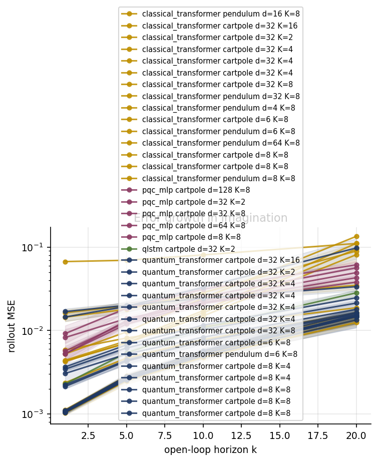
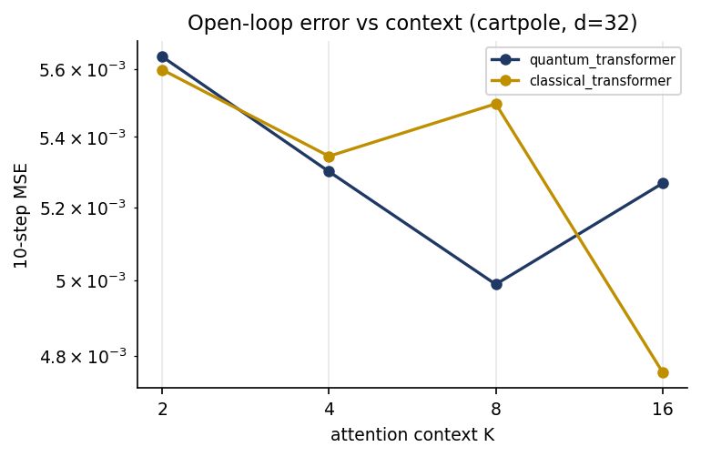
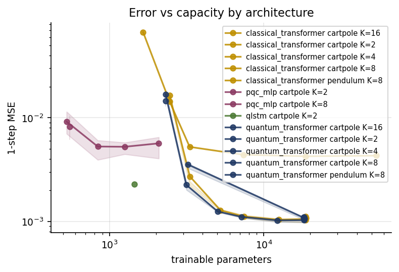
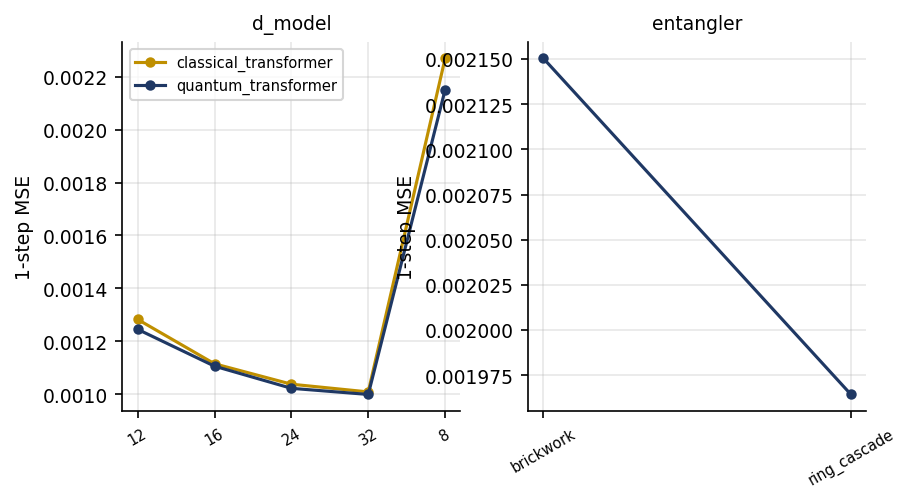
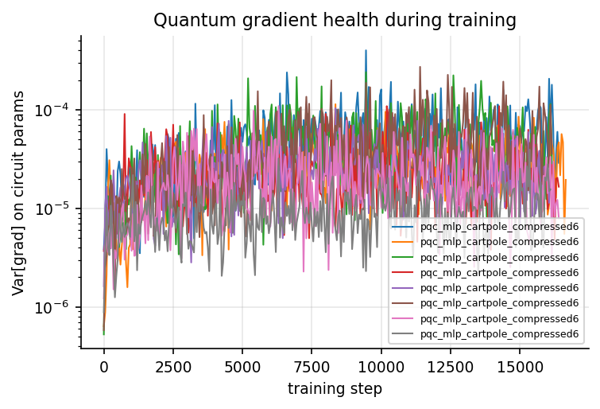

# Phase 1 — Offline Quantum Dynamics Model

231 run(s) aggregated.

> **Note:** runs span 7 capacities ([4, 6, 8, 16, 32, 64, 128]); they are reported separately and must not be pooled.

> **Note:** runs span 4 attention context lengths ([2, 4, 8, 16]); these are a separate axis from capacity and are also reported separately. See the context section below.

> **Note:** runs span 2 tasks (['cartpole', 'pendulum']). These are different environments and are never pooled.

## 1. Model comparison

| task | capacity | context | model | params | quantum params | 1-step [95% CI] | 10-step [95% CI] | seeds |
|---|---|---|---|---|---|---|---|---|
| cartpole | d=6 | K=8 | `classical_transformer` | 2454 | 0 | 0.01637 [0.01501, 0.01767] | 0.02458 [0.02213, 0.02677] | 8 |
| cartpole | d=6 | K=8 | `quantum_transformer` | 2310 | 28 | 0.01687 [0.01552, 0.01803] | 0.02433 [0.02204, 0.02652] | 8 |
| cartpole | d=8 | K=4 | `quantum_transformer` | 3214 | 22 | 0.00344 [0.00324, 0.00366] | 0.01025 [0.00970, 0.01080] | 8 |
| cartpole | d=8 | K=4 | `quantum_transformer` | 3214 | 22 | 0.00366 [0.00322, 0.00418] | 0.01156 [0.01008, 0.01303] | 8 |
| cartpole | d=8 | K=8 | `classical_transformer` | 3316 | 0 | 0.00584 | 0.01114 | 1 |
| cartpole | d=8 | K=8 | `classical_transformer` | 3316 | 0 | 0.00236 [0.00215, 0.00259] | 0.00778 [0.00711, 0.00844] | 5 |
| cartpole | d=8 | K=8 | `pqc_mlp` | 528 | 28 | 0.00919 [0.00467, 0.01355] | 0.03126 [0.02512, 0.03532] | 3 |
| cartpole | d=8 | K=8 | `quantum_transformer` | 3152 | 28 | 0.00305 [0.00209, 0.00494] | 0.00830 [0.00610, 0.01263] | 3 |
| cartpole | d=8 | K=8 | `quantum_transformer` | 3152 | 28 | 0.00223 [0.00198, 0.00247] | 0.00746 [0.00695, 0.00796] | 5 |
| cartpole | d=8 | K=8 | `quantum_transformer` | 3152 | 28 | 0.00214 [0.00199, 0.00235] | 0.00745 [0.00693, 0.00804] | 8 |
| cartpole | d=32 | K=2 | `classical_transformer` | 18652 | 0 | 0.00112 [0.00108, 0.00118] | 0.00560 [0.00515, 0.00605] | 8 |
| cartpole | d=32 | K=2 | `pqc_mlp` | 552 | 28 | 0.00824 [0.00399, 0.01249] | 0.02118 [0.01751, 0.02484] | 2 |
| cartpole | d=32 | K=2 | `qlstm` | 1452 | 112 | 0.00229 [0.00218, 0.00240] | 0.01072 [0.00948, 0.01196] | 2 |
| cartpole | d=32 | K=2 | `quantum_transformer` | 18248 | 28 | 0.00110 [0.00106, 0.00115] | 0.00564 [0.00516, 0.00612] | 8 |
| cartpole | d=32 | K=4 | `classical_transformer` | 18554 | 0 | 0.00107 [0.00102, 0.00114] | 0.00515 [0.00486, 0.00544] | 8 |
| cartpole | d=32 | K=4 | `classical_transformer` | 18652 | 0 | 0.00107 [0.00103, 0.00113] | 0.00534 [0.00501, 0.00568] | 8 |
| cartpole | d=32 | K=4 | `classical_transformer` | 18750 | 0 | 0.00108 [0.00103, 0.00115] | 0.00546 [0.00516, 0.00582] | 8 |
| cartpole | d=32 | K=4 | `quantum_transformer` | 18110 | 20 | 0.00109 [0.00102, 0.00117] | 0.00572 [0.00504, 0.00642] | 8 |
| cartpole | d=32 | K=4 | `quantum_transformer` | 18248 | 28 | 0.00106 [0.00101, 0.00113] | 0.00530 [0.00485, 0.00572] | 8 |
| cartpole | d=32 | K=4 | `quantum_transformer` | 18248 | 28 | 0.00107 [0.00103, 0.00113] | 0.00536 [0.00487, 0.00578] | 8 |
| cartpole | d=32 | K=4 | `quantum_transformer` | 18386 | 36 | 0.00107 [0.00102, 0.00113] | 0.00531 [0.00468, 0.00594] | 8 |
| cartpole | d=32 | K=8 | `classical_transformer` | 18652 | 0 | 0.00107 [0.00101, 0.00113] | 0.00550 [0.00494, 0.00615] | 8 |
| cartpole | d=32 | K=8 | `pqc_mlp` | 840 | 28 | 0.00528 [0.00374, 0.00799] | 0.02159 [0.01853, 0.02352] | 3 |
| cartpole | d=32 | K=8 | `quantum_transformer` | 18248 | 28 | 0.00104 [0.00099, 0.00110] | 0.00499 [0.00460, 0.00537] | 8 |
| cartpole | d=32 | K=16 | `classical_transformer` | 18652 | 0 | 0.00103 [0.00098, 0.00110] | 0.00476 [0.00428, 0.00526] | 8 |
| cartpole | d=32 | K=16 | `quantum_transformer` | 18248 | 28 | 0.00104 [0.00099, 0.00112] | 0.00527 [0.00470, 0.00574] | 8 |
| cartpole | d=64 | K=8 | `pqc_mlp` | 1256 | 28 | 0.00525 [0.00422, 0.00685] | 0.02528 [0.01875, 0.03315] | 3 |
| cartpole | d=128 | K=8 | `pqc_mlp` | 2088 | 28 | 0.00567 [0.00401, 0.00891] | 0.02290 [0.02062, 0.02610] | 3 |
| pendulum | d=4 | K=8 | `classical_transformer` | 1652 | 0 | 0.06709 | 0.08064 | 1 |
| pendulum | d=6 | K=8 | `classical_transformer` | 2448 | 0 | 0.01445 [0.01276, 0.01614] | 0.02845 [0.02533, 0.03175] | 8 |
| pendulum | d=6 | K=8 | `quantum_transformer` | 2304 | 28 | 0.01452 [0.01278, 0.01624] | 0.03288 [0.02668, 0.03992] | 8 |
| pendulum | d=8 | K=8 | `classical_transformer` | 3308 | 0 | 0.00524 | 0.02441 | 1 |
| pendulum | d=16 | K=8 | `classical_transformer` | 7388 | 0 | 0.00440 | 0.01727 | 1 |
| pendulum | d=32 | K=8 | `classical_transformer` | 18620 | 0 | 0.00425 | 0.01626 | 1 |
| pendulum | d=64 | K=8 | `classical_transformer` | 53372 | 0 | 0.00431 | 0.01493 | 1 |

### Phase 1 gate (per task, capacity and context)

**cartpole, d_model = 6, context K = 8**
- **1-step**: quantum/classical = 1.031x (need <= classical) → **FAIL (p=0.32 — underpowered, add seeds)**  _(n=8 seeds, quantum ahead in 2/8)_
- **10-step**: quantum/classical = 0.990x (need <= 2.0x classical) → **PASS (p=0.77 — underpowered, add seeds)**  _(n=8 seeds, quantum ahead in 5/8)_

**cartpole, d_model = 8, context K = 8**
- **1-step**: quantum/classical = 0.944x (need <= classical) → **PASS (p=0.063)**  _(n=5 seeds, quantum ahead in 5/5)_
- **10-step**: quantum/classical = 0.959x (need <= 2.0x classical) → **PASS (p=0.25 — underpowered, add seeds)**  _(n=5 seeds, quantum ahead in 3/5)_

**cartpole, d_model = 8, context K = 8**
- **1-step**: quantum/classical = 0.846x (need <= classical) → **PASS**  _(n=1 seeds, quantum ahead in 1/1)_
- **10-step**: quantum/classical = 1.133x (need <= 2.0x classical) → **PASS**  _(n=1 seeds, quantum ahead in 0/1)_

**cartpole, d_model = 32, context K = 2**
- **1-step**: quantum/classical = 0.984x (need <= classical) → **PASS (p=0.22 — underpowered, add seeds)**  _(n=8 seeds, quantum ahead in 4/8)_
- **10-step**: quantum/classical = 1.007x (need <= 2.0x classical) → **PASS (p=0.86 — underpowered, add seeds)**  _(n=8 seeds, quantum ahead in 2/8)_

**cartpole, d_model = 32, context K = 4**
- **1-step**: quantum/classical = 1.011x (need <= classical) → **FAIL (p=0.40 — underpowered, add seeds)**  _(n=8 seeds, quantum ahead in 4/8)_
- **10-step**: quantum/classical = 1.110x (need <= 2.0x classical) → **PASS (p=0.085)**  _(n=8 seeds, quantum ahead in 1/8)_

**cartpole, d_model = 32, context K = 4**
- **1-step**: quantum/classical = 0.988x (need <= classical) → **PASS (p=0.29 — underpowered, add seeds)**  _(n=8 seeds, quantum ahead in 5/8)_
- **10-step**: quantum/classical = 0.992x (need <= 2.0x classical) → **PASS (p=0.91 — underpowered, add seeds)**  _(n=8 seeds, quantum ahead in 3/8)_

**cartpole, d_model = 32, context K = 4**
- **1-step**: quantum/classical = 0.988x (need <= classical) → **PASS (p=0.34 — underpowered, add seeds)**  _(n=8 seeds, quantum ahead in 6/8)_
- **10-step**: quantum/classical = 0.972x (need <= 2.0x classical) → **PASS (p=0.61 — underpowered, add seeds)**  _(n=8 seeds, quantum ahead in 5/8)_

**cartpole, d_model = 32, context K = 8**
- **1-step**: quantum/classical = 0.975x (need <= classical) → **PASS (p=0.041)**  _(n=8 seeds, quantum ahead in 6/8)_
- **10-step**: quantum/classical = 0.908x (need <= 2.0x classical) → **PASS (p=0.28 — underpowered, add seeds)**  _(n=8 seeds, quantum ahead in 4/8)_

**cartpole, d_model = 32, context K = 16**
- **1-step**: quantum/classical = 1.014x (need <= classical) → **FAIL (p=0.091)**  _(n=8 seeds, quantum ahead in 2/8)_
- **10-step**: quantum/classical = 1.107x (need <= 2.0x classical) → **PASS (p=0.10 — underpowered, add seeds)**  _(n=8 seeds, quantum ahead in 2/8)_

**pendulum, d_model = 6, context K = 8**
- **1-step**: quantum/classical = 1.005x (need <= classical) → **FAIL (p=0.55 — underpowered, add seeds)**  _(n=8 seeds, quantum ahead in 4/8)_
- **10-step**: quantum/classical = 1.156x (need <= 2.0x classical) → **PASS (p=0.26 — underpowered, add seeds)**  _(n=8 seeds, quantum ahead in 1/8)_

Error growth with horizon is the number that matters for a world model: a good 1-step model that diverges by k=10 is useless for imagination-based RL in Phase 2.

## Attention context length (cartpole, d_model = 32)

| context K | 1-step Q | 1-step C | ratio | p | Q ahead | 10-step Q | 10-step C | ratio | p | Q ahead | seeds |
|---|---|---|---|---|---|---|---|---|---|---|---|
| 2 | 0.00110 | 0.00112 | 0.984x | 0.224 | 4/8 | 0.00564 | 0.00560 | 1.007x | 0.860 | 2/8 | 8 |
| 4 | 0.00106 | 0.00107 | 0.988x | 0.290 | 5/8 | 0.00530 | 0.00534 | 0.992x | 0.907 | 3/8 | 8 |
| 8 | 0.00104 | 0.00107 | 0.975x | 0.041 | 6/8 | 0.00499 | 0.00550 | 0.908x | 0.283 | 4/8 | 8 |
| 16 | 0.00104 | 0.00103 | 1.014x | 0.091 | 2/8 | 0.00527 | 0.00476 | 1.107x | 0.103 | 2/8 | 8 |

Absolute 10-step error for the quantum arm moves from 0.00564 at K=2 to 0.00527 at K=16 (improving by 7%); the classical arm moves from 0.00560 to 0.00476. A trend present in both arms is a property of the task, not of the circuit; only a divergence between them supports the architectural claim.

## 2. Capacity curves

| model | task | context | params | 1-step (mean) | seeds |
|---|---|---|---|---|---|
| `classical_transformer` | cartpole | K=16 | 18652 | 0.00103 | 8 |
| `classical_transformer` | cartpole | K=2 | 18652 | 0.00112 | 8 |
| `classical_transformer` | cartpole | K=4 | 18554 | 0.00107 | 8 |
| `classical_transformer` | cartpole | K=4 | 18652 | 0.00107 | 8 |
| `classical_transformer` | cartpole | K=4 | 18750 | 0.00108 | 8 |
| `classical_transformer` | cartpole | K=8 | 2454 | 0.01637 | 8 |
| `classical_transformer` | cartpole | K=8 | 3316 | 0.00272 | 9 |
| `classical_transformer` | cartpole | K=8 | 5232 | 0.00128 | 3 |
| `classical_transformer` | cartpole | K=8 | 7404 | 0.00112 | 3 |
| `classical_transformer` | cartpole | K=8 | 12516 | 0.00104 | 3 |
| `classical_transformer` | cartpole | K=8 | 18652 | 0.00105 | 11 |
| `classical_transformer` | pendulum | K=8 | 1652 | 0.06709 | 1 |
| `classical_transformer` | pendulum | K=8 | 2448 | 0.01445 | 8 |
| `classical_transformer` | pendulum | K=8 | 3308 | 0.00524 | 1 |
| `classical_transformer` | pendulum | K=8 | 7388 | 0.00440 | 1 |
| `classical_transformer` | pendulum | K=8 | 18620 | 0.00425 | 1 |
| `classical_transformer` | pendulum | K=8 | 53372 | 0.00431 | 1 |
| `pqc_mlp` | cartpole | K=2 | 552 | 0.00824 | 2 |
| `pqc_mlp` | cartpole | K=8 | 528 | 0.00919 | 3 |
| `pqc_mlp` | cartpole | K=8 | 840 | 0.00528 | 3 |
| `pqc_mlp` | cartpole | K=8 | 1256 | 0.00525 | 3 |
| `pqc_mlp` | cartpole | K=8 | 2088 | 0.00567 | 3 |
| `qlstm` | cartpole | K=2 | 1452 | 0.00229 | 2 |
| `quantum_transformer` | cartpole | K=16 | 18248 | 0.00104 | 8 |
| `quantum_transformer` | cartpole | K=2 | 18248 | 0.00110 | 8 |
| `quantum_transformer` | cartpole | K=4 | 3214 | 0.00355 | 16 |
| `quantum_transformer` | cartpole | K=4 | 18110 | 0.00109 | 8 |
| `quantum_transformer` | cartpole | K=4 | 18248 | 0.00107 | 16 |
| `quantum_transformer` | cartpole | K=4 | 18386 | 0.00107 | 8 |
| `quantum_transformer` | cartpole | K=8 | 2310 | 0.01687 | 8 |
| `quantum_transformer` | cartpole | K=8 | 3152 | 0.00225 | 25 |
| `quantum_transformer` | cartpole | K=8 | 5028 | 0.00125 | 3 |
| `quantum_transformer` | cartpole | K=8 | 7160 | 0.00111 | 3 |
| `quantum_transformer` | cartpole | K=8 | 12192 | 0.00102 | 3 |
| `quantum_transformer` | cartpole | K=8 | 18248 | 0.00103 | 11 |
| `quantum_transformer` | pendulum | K=8 | 2304 | 0.01452 | 8 |

A curve that flattens ABOVE another architecture's floor is representationally limited, not merely undersized — extra parameters cannot close the gap. A curve shifted left at equal error is more parameter-efficient.

## 3. Ablations

### d_model

| value | model | 1-step mean | n |
|---|---|---|---|
| `12` | classical_transformer | 0.00128 | 3 |
| `16` | classical_transformer | 0.00112 | 3 |
| `24` | classical_transformer | 0.00104 | 3 |
| `32` | classical_transformer | 0.00101 | 3 |
| `8` | classical_transformer | 0.00227 | 3 |
| `12` | quantum_transformer | 0.00125 | 3 |
| `16` | quantum_transformer | 0.00111 | 3 |
| `24` | quantum_transformer | 0.00102 | 3 |
| `32` | quantum_transformer | 0.00100 | 3 |
| `8` | quantum_transformer | 0.00215 | 3 |

### entangler

| value | model | 1-step mean | n |
|---|---|---|---|
| `brickwork` | quantum_transformer | 0.00215 | 3 |
| `ring_cascade` | quantum_transformer | 0.00196 | 3 |

## 3. Gradient health

Circuit-parameter gradient variance over training. A curve that decays steadily toward zero means the circuit has stopped learning while the classical wrapper keeps improving — the failure mode that makes a 'quantum' result actually classical. Compare the starting magnitude against the Phase 0 baseline at the same width.

## Notes

- Rollout errors are OPEN-LOOP: the model consumes its own predictions, which is how a world model is used in Phase 2.
- Comparisons are paired across matched seeds; a `p > 0.10` verdict means underpowered, not equivalent.
- Every run records its `dataset_version`; results from different trajectory versions are not comparable and should not be pooled.

