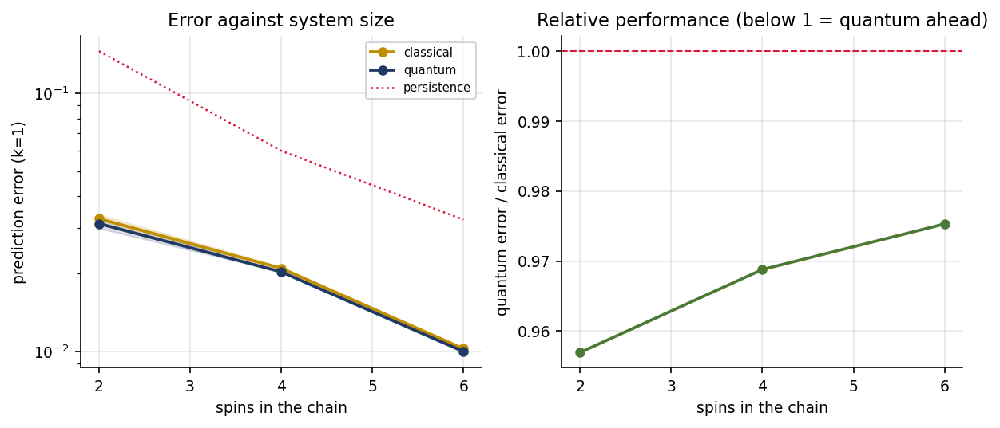

# Phase 3 Stage A — Quantum-Native Dynamics

18 runs. Reported at horizon k = 1.

Both architectures have a FIXED size while the quantum system they model grows. The question is which degrades more slowly.

## Error by system size

| spins | quantum | classical | ratio q/c | seeds | quantum ahead | p |
|---|---|---|---|---|---|---|
| 2 | 0.03128 | 0.03268 | **0.957** | 3 | 2/3 | 0.743 |
| 4 | 0.02032 | 0.02098 | **0.969** | 3 | 3/3 | 0.247 |
| 6 | 0.00998 | 0.01023 | **0.975** | 3 | 2/3 | 0.493 |

A ratio below 1 means the quantum model is ahead. The trend across rows is the result, not any single row.

### Does the gap widen?

- Ratio at 2 spins: **0.957**
- Ratio at 6 spins: **0.975**
- Linear trend in the ratio: **+0.0046 per added spin**

**The ratio is flat.** Neither architecture degrades faster. Whatever difference exists at one size is not a scaling effect, and the hypothesis that quantum models suit quantum systems is not supported by this evidence.

## Is the task well-posed at each size?

| spins | persistence | classical model | ×persistence | R² |
|---|---|---|---|---|
| 2 | 0.14588 | 0.03030 | 4.8× | 0.8931 |
| 4 | 0.05993 | 0.02142 | 2.8× | 0.8448 |
| 6 | 0.03240 | 0.01040 | 3.1× | 0.8873 |

A model scoring close to persistence has not learned the dynamics, and a comparison at that size says nothing. A model at R² above 0.999 may be at the task's ceiling, where architectures cannot differ — the saturation problem found in Phase 1.

## Notes

- Model size is FIXED across system sizes by design; only the system grows.
- The train/test split is fixed across seeds, so seeds vary only model initialisation — a deliberate change from Phase 1, which varied the partition too and lost statistical power to it.
- Comparisons are paired within seed. A p above 0.10 means underpowered, not equivalent.
- Observations are exact expectation values with no measurement noise. Finite-shot behaviour is a separate question.

