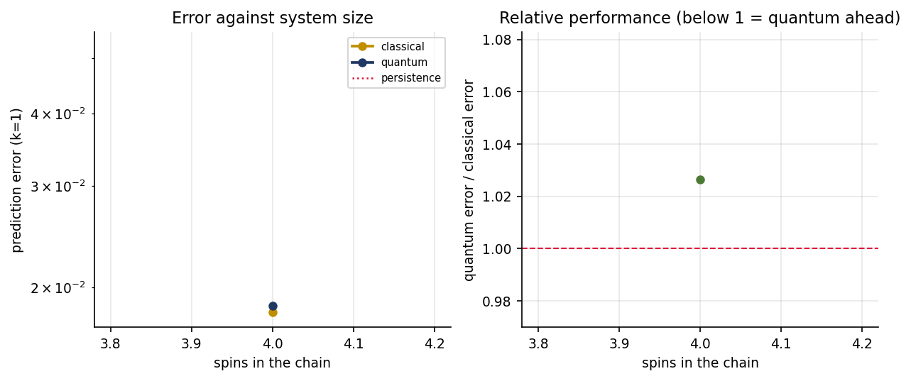

# Phase 3 Stage A — Quantum-Native Dynamics

6 runs, all at observables = `zx`, d_model = 16. Reported at horizon k = 1.

Both architectures have a FIXED size while the quantum system they model grows. The question is which degrades more slowly.

## Error by system size

| spins | quantum | classical | ratio q/c | seeds | quantum ahead | p |
|---|---|---|---|---|---|---|
| 4 | 0.01856 | 0.01808 | **1.026** | 3 | 1/3 | 0.750 |

A ratio below 1 means the quantum model is ahead. The trend across rows is the result, not any single row.

## Is the task well-posed at each size?

| spins | persistence | classical model | ×persistence | R² |
|---|---|---|---|---|
| 4 | 0.05257 | 0.01804 | 2.9× | 0.8260 |

A model scoring close to persistence has not learned the dynamics, and a comparison at that size says nothing. A model at R² above 0.999 may be at the task's ceiling, where architectures cannot differ — the saturation problem found in Phase 1.

## Notes

- Model size is FIXED across system sizes by design; only the system grows.
- The train/test split is fixed across seeds, so seeds vary only model initialisation — a deliberate change from Phase 1, which varied the partition too and lost statistical power to it.
- Comparisons are paired within seed. A p above 0.10 means underpowered, not equivalent.
- Observations are exact expectation values with no measurement noise. Finite-shot behaviour is a separate question.

