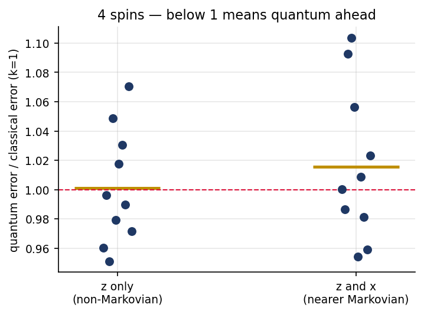

# Phase 3 — the observables contrast

System size 4 spins, model width 16, horizon k = 1.

The scaling sweep was a proxy for the real hypothesis. This is the direct test: remove the non-Markovianity and see whether the quantum model's edge goes with it.

## Each arm

### `--observables zx` — z and x (nearer Markovian)

| seed | quantum | classical | ratio q/c | ahead |
|---|---|---|---|---|
| 0 | 0.01796 | 0.01795 | **1.000** | classical |
| 1 | 0.01802 | 0.01826 | **0.987** | quantum |
| 2 | 0.01971 | 0.01804 | **1.093** | classical |
| 3 | 0.01943 | 0.01760 | **1.104** | classical |
| 4 | 0.01831 | 0.01733 | **1.056** | classical |
| 5 | 0.01805 | 0.01892 | **0.954** | quantum |
| 6 | 0.01770 | 0.01755 | **1.009** | classical |
| 7 | 0.01814 | 0.01849 | **0.981** | quantum |
| 8 | 0.01763 | 0.01839 | **0.959** | quantum |
| 9 | 0.01786 | 0.01746 | **1.023** | classical |

- Mean ratio **1.017**, geometric mean **1.015**
- Quantum ahead in **4 of 10** seeds (exact sign test p = 0.754)
- Task difficulty: classical model is 3.0x better than persistence, R² = 0.8316, observation dimension 8

### `--observables z` — z only (non-Markovian)

| seed | quantum | classical | ratio q/c | ahead |
|---|---|---|---|---|
| 0 | 0.02027 | 0.02111 | **0.960** | quantum |
| 1 | 0.02033 | 0.02041 | **0.996** | quantum |
| 2 | 0.02037 | 0.02142 | **0.951** | quantum |
| 3 | 0.02046 | 0.01951 | **1.049** | classical |
| 4 | 0.02028 | 0.02071 | **0.979** | quantum |
| 5 | 0.02012 | 0.01977 | **1.017** | classical |
| 6 | 0.02091 | 0.02029 | **1.031** | classical |
| 7 | 0.02066 | 0.02088 | **0.990** | quantum |
| 8 | 0.02085 | 0.01948 | **1.071** | classical |
| 9 | 0.01992 | 0.02051 | **0.972** | quantum |

- Mean ratio **1.002**, geometric mean **1.001**
- Quantum ahead in **6 of 10** seeds (exact sign test p = 0.754)
- Task difficulty: classical model is 2.9x better than persistence, R² = 0.8515, observation dimension 4

## Does the edge depend on non-Markovianity?

- Geometric-mean ratio, non-Markovian (`z`): **1.001**
- Geometric-mean ratio, nearer-Markovian (`zx`): **1.015**
- Shift between arms: **+1.5 percentage points** toward classical
- Permutation test on mean log-ratio: **p = 0.483** (184756 arrangements, 10 vs 10 seeds)

**Directionally consistent with the hypothesis**: the quantum model's relative position worsens when the task is made more Markovian, though it does not cross 1.

## Is the comparison capacity-limited?

If both architectures sat on the task's ceiling, neither could distinguish itself and the whole comparison would be measuring noise. This is the classical model alone, widened until it stops improving.

| d_model | params | error (k=1) | R² | × persistence |
|---|---|---|---|---|
| 8 | 3306 | 0.02676 | 0.8061 | 2.2× |
| 16 | 7386 | 0.02111 | 0.8471 | 2.8× |
| 32 | 18618 | 0.01973 | 0.8571 | 3.0× |
| 64 | 53370 | 0.01768 | 0.8719 | 3.4× |

- 16× the parameters buys a 34% error reduction, and the curve has not flattened.
- So d_model = 16 sits in the capacity-limited regime, not at the ceiling. Architecture can still matter here, which is the precondition for the comparison to mean anything.
- It also means the quantum model's few per cent is worth far less than simply widening the classical one: going to d_model = 64 beats it outright, on a machine, in 38 seconds.

## Caveats

- The two arms are different tasks. Only the within-arm ratio is comparable across them; the raw errors are not.
- Seeds vary model initialisation only; the data split is fixed.
- Observations are exact expectation values. Finite-shot behaviour is untested.
- Wall-clock times on this machine are contaminated by other load and by sleep, so they bound the quantum overhead from below only.

