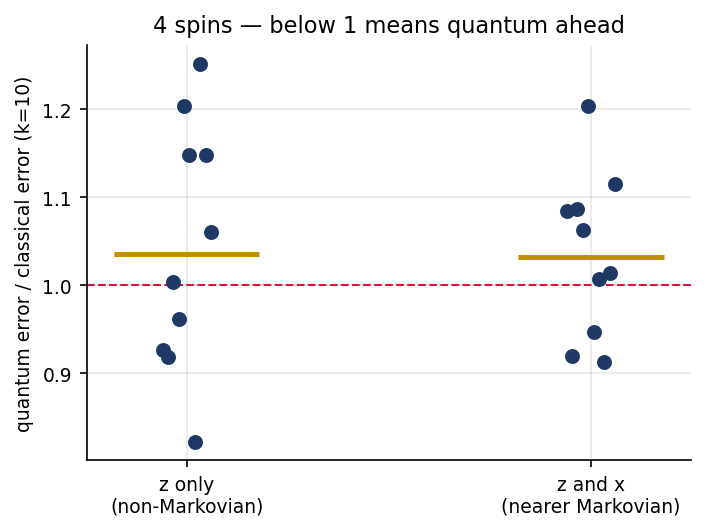

# Phase 3 — the observables contrast

System size 4 spins, model width 16, horizon k = 10.

The scaling sweep was a proxy for the real hypothesis. This is the direct test: remove the non-Markovianity and see whether the quantum model's edge goes with it.

## Each arm

### `--observables zx` — z and x (nearer Markovian)

| seed | quantum | classical | ratio q/c | ahead |
|---|---|---|---|---|
| 0 | 0.08568 | 0.07899 | **1.085** | classical |
| 1 | 0.07423 | 0.08073 | **0.919** | quantum |
| 2 | 0.08407 | 0.07735 | **1.087** | classical |
| 3 | 0.08417 | 0.07923 | **1.062** | classical |
| 4 | 0.09290 | 0.07716 | **1.204** | classical |
| 5 | 0.07336 | 0.07744 | **0.947** | quantum |
| 6 | 0.07915 | 0.07859 | **1.007** | classical |
| 7 | 0.07372 | 0.08075 | **0.913** | quantum |
| 8 | 0.08141 | 0.08025 | **1.014** | classical |
| 9 | 0.11000 | 0.09866 | **1.115** | classical |

- Mean ratio **1.035**, geometric mean **1.032**
- Quantum ahead in **3 of 10** seeds (exact sign test p = 0.344)
- Task difficulty: classical model is 3.0x better than persistence, R² = 0.8316, observation dimension 8

### `--observables z` — z only (non-Markovian)

| seed | quantum | classical | ratio q/c | ahead |
|---|---|---|---|---|
| 0 | 0.12377 | 0.13366 | **0.926** | quantum |
| 1 | 0.11683 | 0.12721 | **0.918** | quantum |
| 2 | 0.11121 | 0.11082 | **1.004** | classical |
| 3 | 0.11975 | 0.12449 | **0.962** | quantum |
| 4 | 0.13788 | 0.11455 | **1.204** | classical |
| 5 | 0.12343 | 0.10755 | **1.148** | classical |
| 6 | 0.12035 | 0.14633 | **0.822** | quantum |
| 7 | 0.14185 | 0.11330 | **1.252** | classical |
| 8 | 0.13829 | 0.12048 | **1.148** | classical |
| 9 | 0.12940 | 0.12196 | **1.061** | classical |

- Mean ratio **1.044**, geometric mean **1.036**
- Quantum ahead in **4 of 10** seeds (exact sign test p = 0.754)
- Task difficulty: classical model is 2.9x better than persistence, R² = 0.8515, observation dimension 4

## Does the edge depend on non-Markovianity?

- Geometric-mean ratio, non-Markovian (`z`): **1.036**
- Geometric-mean ratio, nearer-Markovian (`zx`): **1.032**
- Shift between arms: **-0.4 percentage points** toward classical
- Permutation test on mean log-ratio: **p = 0.937** (184756 arrangements, 10 vs 10 seeds)

**Not consistent with the hypothesis.** The quantum model's relative position is unchanged by removing the non-Markovianity, so whatever difference exists is not about history.

## Caveats

- The two arms are different tasks. Only the within-arm ratio is comparable across them; the raw errors are not.
- Seeds vary model initialisation only; the data split is fixed.
- Observations are exact expectation values. Finite-shot behaviour is untested.
- Wall-clock times on this machine are contaminated by other load and by sleep, so they bound the quantum overhead from below only.

